# Megademo

[](LICENSE)

[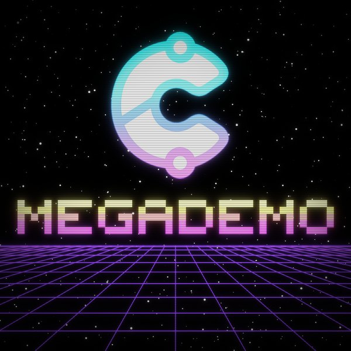](https://youtu.be/6fKMwrOik5k)

Back in the 1980s and 1990s computers were fun. Young pioneering developers, inspired by the games and demos on machines like the C64 and Amiga, made their own, using code, graphics and sound in creative ways. Many people learned to code that way, and used the trigonometry they had learned at school to push the hardware further than anyone thought it would go. It was a creative artform.

So I made Circuitry Studio: an IDE with all the tools to make creative coding fun and visual, using simple Python or JavaScript. It comes with libraries for graphics, a synthesizer and sound engine, and visual effects. It can also export a video in perfect frame sync with the music, to share online.

This Megademo is made in [Circuitry Studio](https://www.circuitry.dev) in that spirit: a chiptune and twelve parts of effects cut to it, in one file of JavaScript, with the same demo in Python beside it. It lasts 3 minutes 5 seconds, then goes round again.

**[Watch it on YouTube →](https://youtu.be/6fKMwrOik5k)**

It opens as an old computer would, with a few words typed on its screen that say what a demo was. Then the title glitches in, copper bars run over water, a plasma folds in a kaleidoscope, a tunnel, a cube over a chessboard floor, an arcade game that plays itself, a lava lamp, a rotozoom, an equaliser, greetings, a finale with a new trick on every beat, and credits that crawl away into the stars.

## The scenes

| | | |
|---|---|---|
| 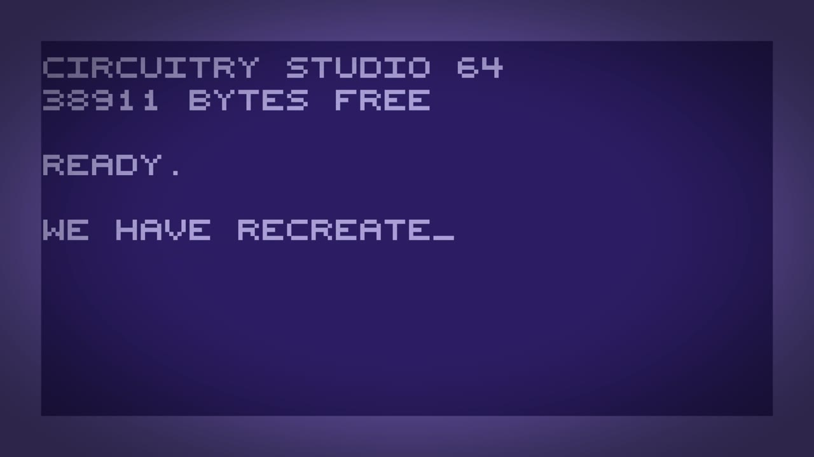 **0:00 Booting up: what is a demo?** | 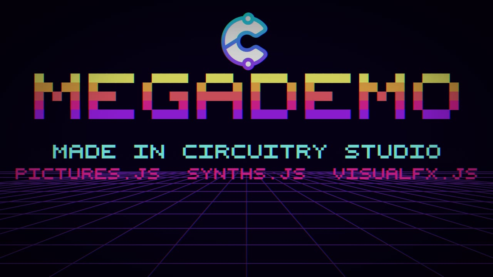 **0:14 Title** | 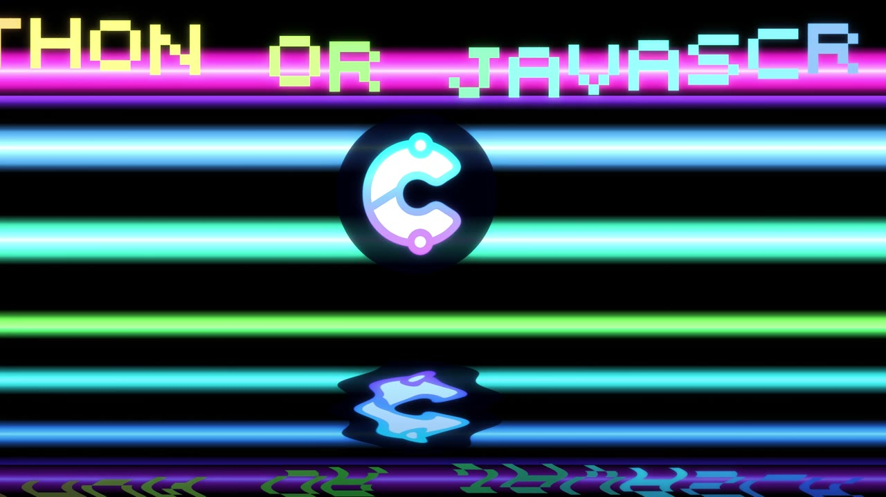 **0:27 Copper bars and a sine scroller** |
| 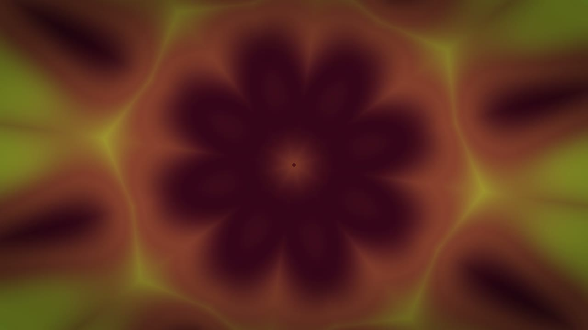 **0:48 Plasma in a kaleidoscope** | 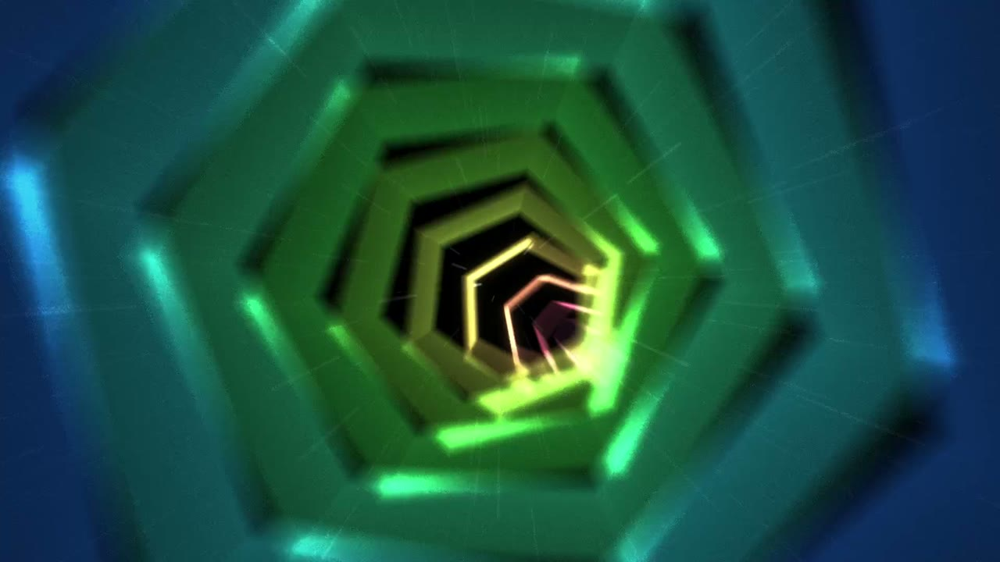 **1:02 Tunnel** | 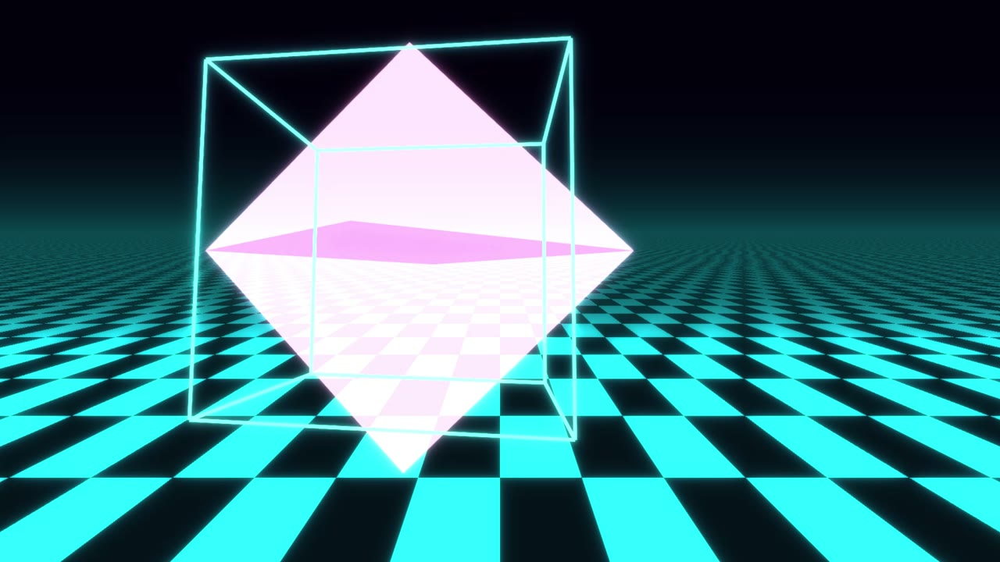 **1:15 Vectors: a cube, a glass shape, and down the tunnel** |
| 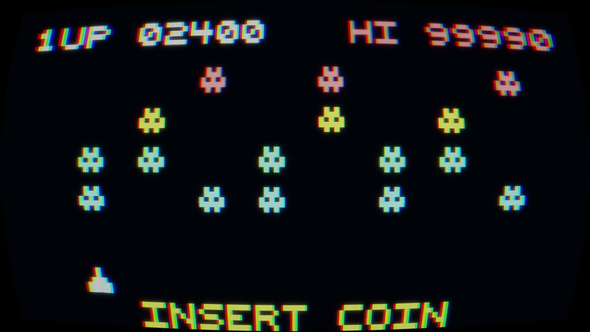 **1:29 Arcade** | 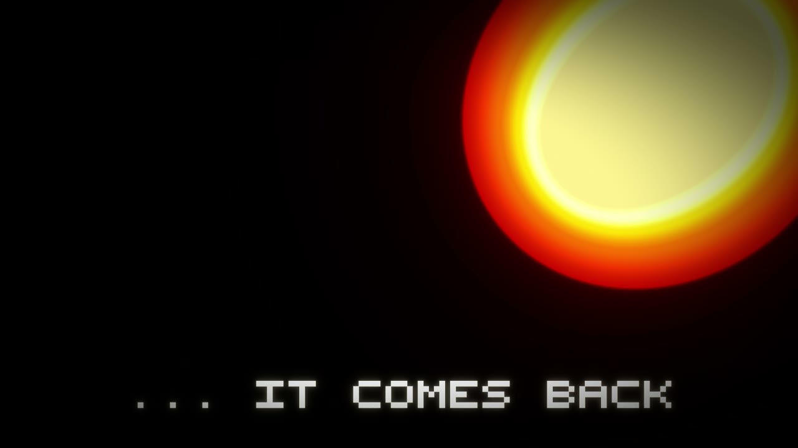 **1:43 Lava** | 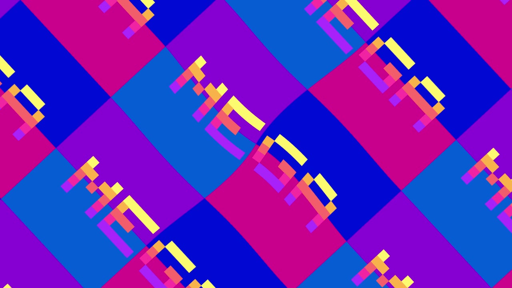 **1:57 Rotozoom** |
| 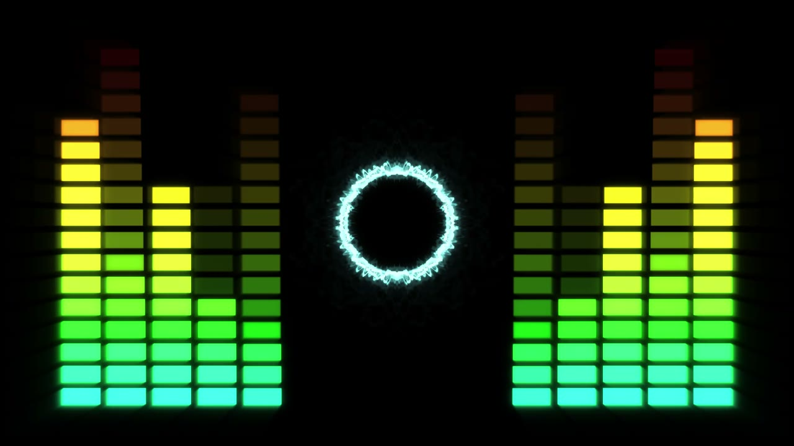 **2:10 Equaliser** | 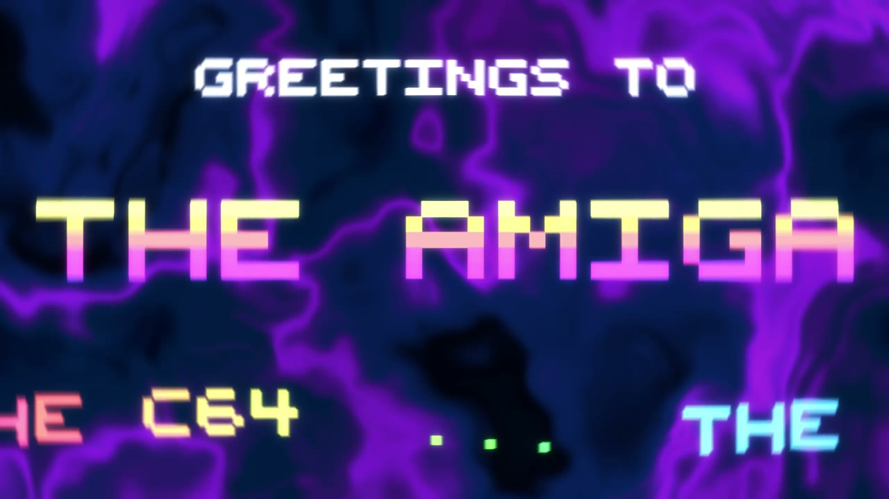 **2:24 Greetings** | 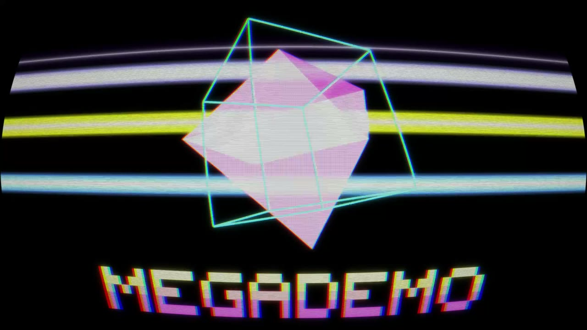 **2:38 Finale** |
| 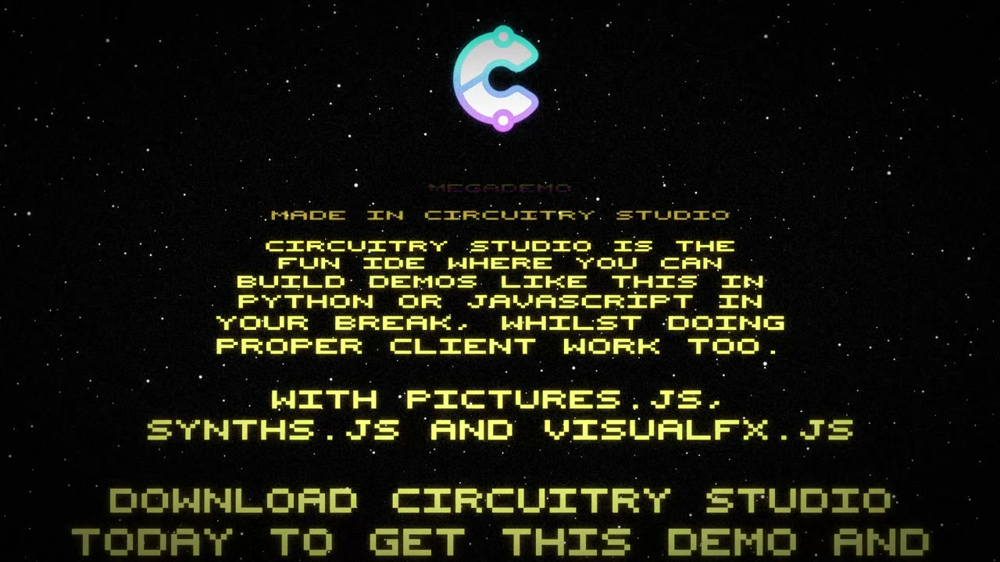 **2:51 Credits** | | |

## How to run it

### The easiest way: Circuitry Studio

Get [Circuitry Studio](https://www.circuitry.dev), the desktop app or in your browser, and open Megademo from the Demos folder. It opens with its code beside its picture. It asks first whether to play with sound or without, so nobody is surprised in a quiet room; the speaker in the corner (or the M key) switches the sound later. A tap or a key skips to the next part, the left arrow goes back one, and P shows the poster.

Everything runs there as it is, in JavaScript or in Python: open `main.js` or `main.py` and run it. Change anything you like, the demo you open is your own copy.

### Outside Circuitry, in a web browser

The demo is three free libraries and three files. The libraries:

| | JavaScript | Python |
|---|---|---|
| Draws | [pictures.js](https://github.com/johnwylie70/pictures.js) | [Pyctures](https://github.com/johnwylie70/pyctures) |
| Plays the tune | [synths.js](https://github.com/johnwylie70/synths.js) | [synths](https://github.com/johnwylie70/synths-py) |
| Effects on the graphics card | [visualfx.js](https://github.com/johnwylie70/visualfx.js) | [pyvisualfx](https://github.com/johnwylie70/pyvisualfx) |

The three files that go with the code are in this repository: `megademo.json` (the tune) and `circuitry-logo.png` (the Circuitry mark) must sit in the same folder as `main.js` or `main.py`.

#### One file, from Circuitry: File → Export as Web Page

The simplest way to give the demo to someone who has nothing installed. In Circuitry Studio open `main.js` and choose **File → Export as Web Page…**. Circuitry writes **one `.html` file** with the demo, the libraries, the tune and the logo all inside it. Double-click it to run it in any browser, or put it on a website. It needs no connection.

A Python scene that makes sound cannot be exported yet; run `main.py` as below.

#### JavaScript, on your own computer

You need [Node.js](https://nodejs.org) 20 or newer. pictures.js carries the sound and the effects (the `sound` and `visualfx` folders). The copy on GitHub has them, so use that:

```bash
git clone https://github.com/johnwylie70/pictures.js
git clone https://github.com/johnwylie70/megademo
cd pictures.js
node bin/pictures.mjs run ../megademo/main.js
```

Your browser opens on the demo. Save the file and it runs again. To get a folder of plain files for any web host:

```bash
node bin/pictures.mjs build ../megademo/main.js -o ../megademo-site
```

#### Python, on your own computer

You need Python 3.9 or newer. The demo runs in your own Python and draws in your browser. Take Pyctures from GitHub, which has the sound and the effects built in:

```bash
git clone https://github.com/johnwylie70/pyctures
git clone https://github.com/johnwylie70/megademo
pip install -e pyctures
pip install synths pyvisualfx
cd megademo
pyctures run main.py
```

Your browser opens on the demo. Save the file and it runs again. (When the next Pyctures is released, `pip install pyctures` will be enough.)

### Use the libraries in a scene of your own

Here is a small scene that does what the demo does in three lines: it plays a tracker song, fills the screen with a plasma and folds it in a kaleidoscope. Put it beside `megademo.json`, or any song of your own.

**JavaScript** (`mini.js`): nothing to import, the names are ready in every pictures.js scene.

```js
playSong("megademo.json")          // synths.js: a tracker song
plasma("sunset")                   // visualfx.js: a whole backdrop from the graphics card
kaleidoscope(8)                    // visualfx.js: fold what is drawn, eight ways
glow(0.6)

let t = 0
function update(dt) { t += dt }

function draw() {
  background()                     // no colour: wipe the picture clear so the plasma shows
  for (let i = 0; i < 6; i++) {
    circle(width / 2 + 120 * Math.cos(t + i), height / 2 + 120 * Math.sin(t + i), 20, "white")
  }
}
```

```bash
node bin/pictures.mjs run /path/to/mini.js        # from the pictures.js folder
```

**Python** (`mini.py`): the same scene, with the three libraries imported.

```python
import math
from pyctures import *
from synths import *
from pyvisualfx import *

play_song("megademo.json")         # synths: a tracker song
plasma("sunset")                   # pyvisualfx: a whole backdrop from the graphics card
kaleidoscope(8)                    # pyvisualfx: fold what is drawn, eight ways
glow(0.6)

t = 0

def update(dt):
    global t
    t += dt

def draw():
    background()                   # no colour: wipe the picture clear so the plasma shows
    for i in range(6):
        circle(width / 2 + 120 * math.cos(t + i), height / 2 + 120 * math.sin(t + i), 20, "white")
```

```bash
pyctures run mini.py
```

To put a JavaScript scene on a page of your own, see [Use it on your website](https://github.com/johnwylie70/pictures.js/blob/main/docs/website.md) in pictures.js: a `<div data-pictures-src="mini.js">`, one script tag, and the `sound` and `visualfx` folders of pictures.js beside `pictures.js` for a scene that plays a song or uses an effect.

## How the effects were made

Nothing here is a video. Each scene is drawn live by the code in `main.js`, and the graphics card does the effects. Each effect is one line to turn on, and its settings can be changed while the scene runs. The demo uses about forty of them, never more than four at once, and one shader of its own (the water under the copper bars).

| Scene | What makes it |
|---|---|
| **Booting up** | The words are typed a screen at a time on pictures.js. `scanlines` and `vignette` from visualfx.js give the old glass. |
| **Title** | `glitch` tears the picture on the beat, `floorGrid` draws the neon grid, and `scanlines` and `vignette` finish it. Every letter is five rows of five dots, drawn by the scene. |
| **Copper bars and a sine scroller** | `copperBars("rainbow")` is the whole backdrop. The water under it is a short shader of the demo's own, and `glow` lights it. The Circuitry mark and the scroller are drawn with pictures.js. |
| **Plasma in a kaleidoscope** | `plasma("sunset")` draws the backdrop and `kaleidoscope(8)` folds it. Its `zoom` is set from the kick drum every frame. |
| **Tunnel** | Rings drawn with pictures.js's `polygon`, a new ring size every bar. `zoomBlur` and `glow` from visualfx.js give the rush. |
| **Vectors** | `checkerFloor` is the floor. The cube and the glass shape are drawn by the scene itself, turned in 3D with a few lines of arithmetic. `rgbSplit` jumps on the snare and `punch` on the kick. Half way, `tunnel` turns the whole picture into the walls of a tunnel. |
| **Arcade** | `look("arcade")`, one ready-made look: a glow and the curved glass of an old screen. The game is a few lines of pictures.js. |
| **Lava** | `metaballs("lava")` with a `glow`. Nothing is drawn but a few words: the lava is all the graphics card's. |
| **Rotozoom** | One picture is drawn, four squares with a word across them, and `rotozoom` turns it, zooms it and repeats it. |
| **Equaliser** | `waveformRing` bends the sound's own wave into a ring, `mirror("left")` draws one half and reflects it, and `trails` leaves the glow behind. The columns come from the song's channels. |
| **Greetings** | `flow` is the moving backdrop and `spinBlur` spins each name in. |
| **Finale** | A new trick every two beats, then every beat, each one line: `mirror`, `tile`, `hexagons`, `kaleidoscope`, `dither`, `edges`, `swirl`, `colourCycle`, `dots`, `fisheye`, `led`, `wobble`, `crt`, `glitch` and more. `shake` rides the kick drum. See `TRICKS` in `main.js`. |
| **Credits** | `starfield`, `glow` and `grain`, with the words drawn smaller and higher the further they have crawled. |

All of them are written the same way: a part is two small functions, one that turns its effects on when it starts and one that draws it. A part of your own is two functions and a line in `TIMELINE`.

The effects are in [visualfx.js](https://github.com/johnwylie70/visualfx.js) (and [pyvisualfx](https://github.com/johnwylie70/pyvisualfx) for Python), which lists every effect and look with a picture.

## The music

The tune is a tracker song, made in Circuitry Studio's tracker and played by [synths.js](https://github.com/johnwylie70/synths.js) (or [synths](https://github.com/johnwylie70/synths-py) in Python). `megademo.json` is the song in the sound library's own format, which is text you can read: A minor, 140 beats a minute, six channels (a lead, chords played as fast arpeggios on one voice, a bass, drums, hats and a second voice). It changes key to B minor for the last third and comes home through E to loop. It was written for this demo, note by note, and quotes no other tune, game or demo.

## How it stays in time

Nothing looks at the clock on the wall. Each frame the demo asks the song where it is (which pattern, which row, which tick) and works everything out from that: which part to show, how far the scroller has moved, where the cube has turned to. A cut happens on the very frame the song reaches the next pattern. It also reads `megademo.json` itself once, so it knows which rows have a kick drum, a snare or a note on them, and flashes exactly there.

**[MAKING-OF.md](MAKING-OF.md)** is a good reference for how the demo was put together: the timeline, the tune, every part in turn, the letters, fitting any screen, and how to make a demo of your own.

## What to change

All near the top of `main.js` and `main.py`:

- The words: `PROLOGUE` (the opening screens), `PITCH` and `DOWNLOAD` (what the scroller and the credits say), `GREETINGS` and `CREDITS`.
- `TIMELINE`: each line says from which pattern of the song a part runs. Swap the names in two lines and two parts change places.
- `SUNSET`, the five colours of the big letters, and `TRICKS`, the effects the finale runs through.
- `circuitry-logo.png`: put a picture of your own in its place and the demo is yours.
- `FONT`, at the bottom: every letter is five rows of five dots.

## What is in this repository

- `main.js` is the demo, and `main.py` is the demo in Python. They are written to be read side by side.
- `megademo.json` is the tune.
- `circuitry-logo.png` is the Circuitry mark.
- `MAKING-OF.md` is how it was made.
- `images/` are the pictures in this page.

## Licence

MIT. See [LICENSE](LICENSE). The Circuitry mark, `circuitry-logo.png`, is Circuitry's and is not covered by it.

Author: John Wylie
